<p align="center">
  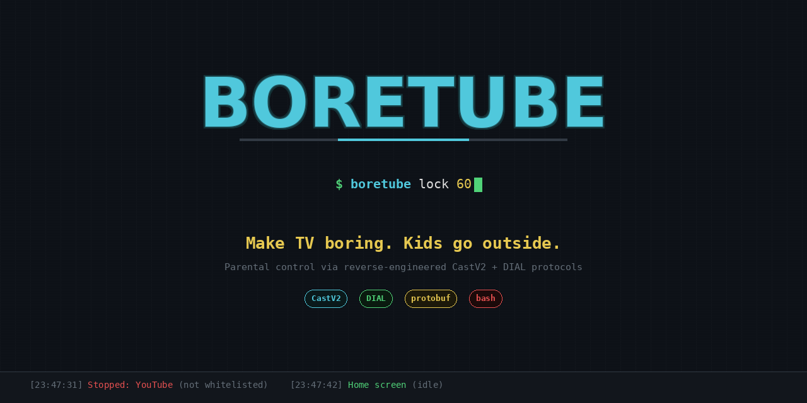
</p>

# boretube

**Run the family Google TV from your phone.** Mute it, close apps, cap the volume, or give the TV a break. Set rules that the TV keeps enforcing even when your phone is away, and keep the TV clean and free of YouTube Shorts after every update.

It was built for a Sony BRAVIA (Google TV 14) and a kid hooked on Shorts. It works with other Google/Android TVs at whatever level they allow.

| Part | What it is |
|---|---|
| [`boretube-mobile/`](boretube-mobile/) | **Boretube 2**, the Android phone app (Flutter). Finds TVs on Wi-Fi, gives you quick controls, edits rules, checks the TV's health, maintains it, and restores it |
| [`boretube-agent/`](boretube-agent/) | **TV Guard**, an *optional* small app on the TV (Kotlin). Enforces rules and breaks 24/7 and runs a watchdog after updates |
| [`debloat/`](debloat/) | Plain-`adb` debloat kit: per-model lists plus snapshot / apply / check / restore scripts |
| [`docs/knowledge/`](docs/knowledge/) | **Everything we verified and researched.** Start here before experimenting. Also read [`AGENTS.md`](AGENTS.md) |

## Screenshots

<p>
  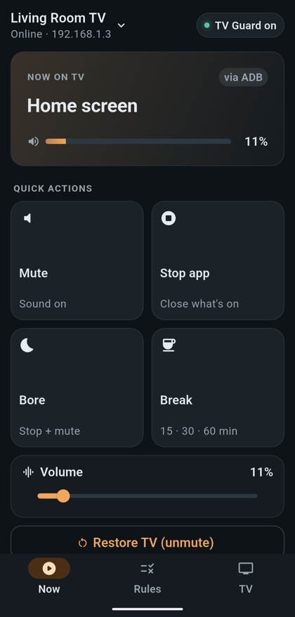
  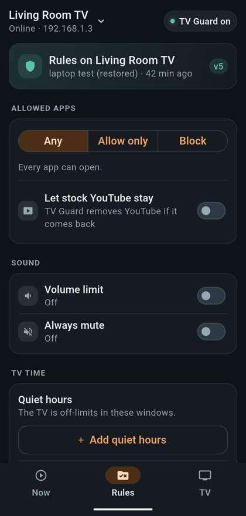
  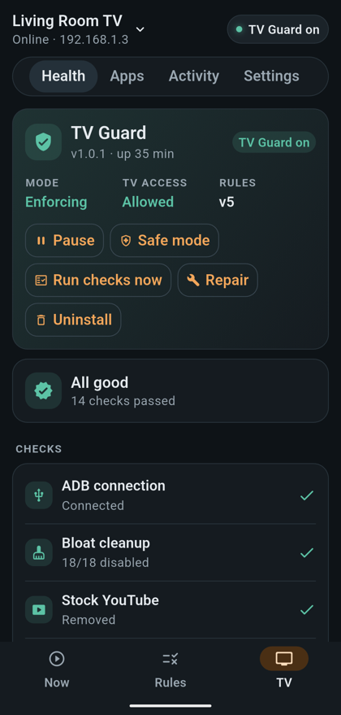
  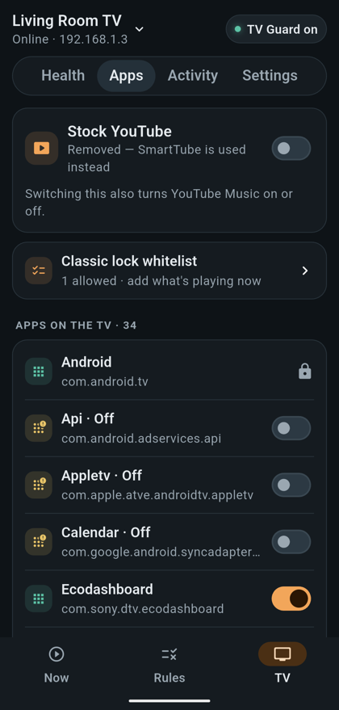
</p>
<p>
  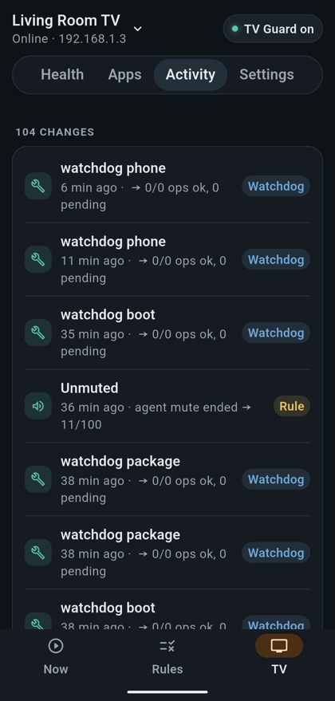
  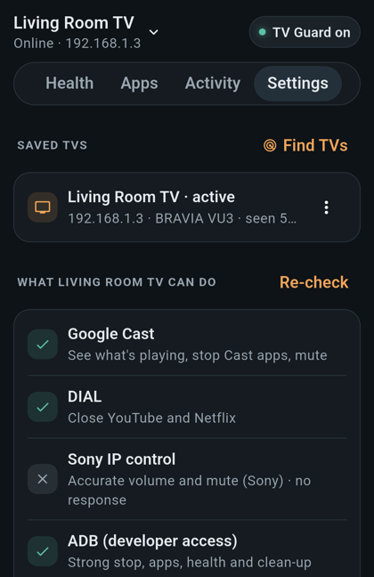
  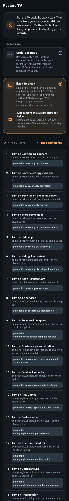
  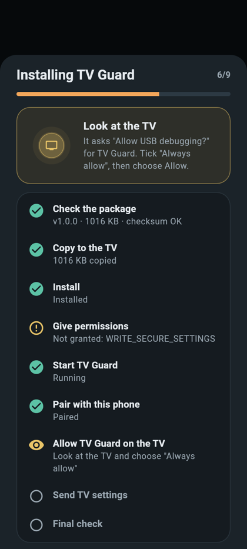
</p>
<p>
  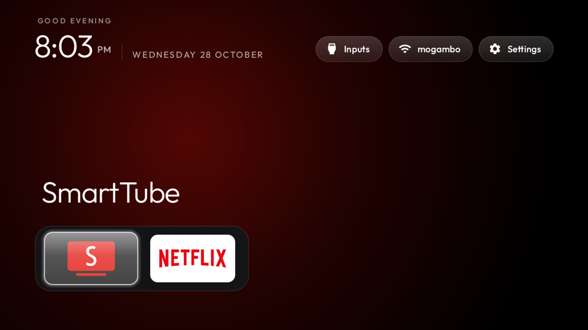
  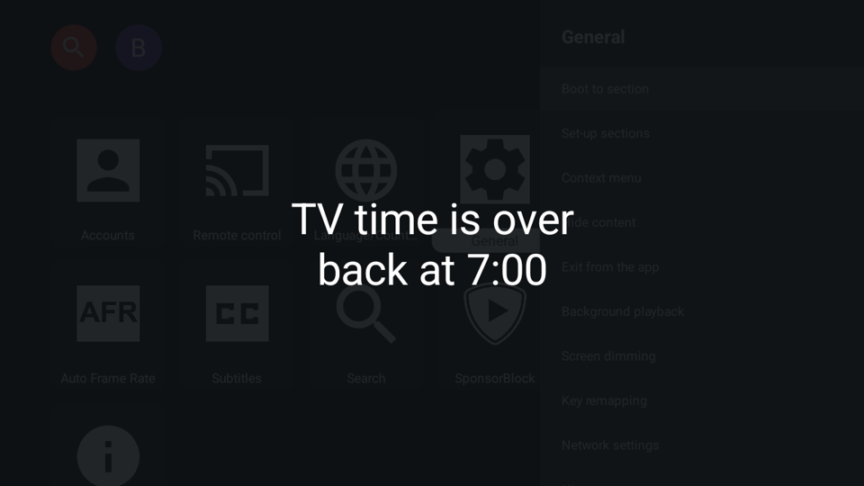
</p>

The phone screenshots were taken on a Pixel 9 Pro XL running against the real TV. Images whose names start with `render-` are rendered test screens using sample data.

## What you get, by how much the TV allows

| TV has… | You get |
|---|---|
| **Cast only** (any Google/Android TV, no setup) | Mute, stop app, bore (stop + mute), volume, restore, and a classic timed lock with a whitelist |
| **+ ADB** (one-time Developer options setup) | Faster and more reliable control, a Break with countdown, and TV health checks with Fix: cleanup status, stock YouTube removed, Speech Services build, Home launcher. Also apps on/off, a stock YouTube toggle, a change journal, and **Restore TV** |
| **+ TV Guard** (optional, one tap from the app) | Rules enforced on the TV around the clock, even with your phone off: allowed apps, volume limit, always mute, quiet hours, daily limit, sneaky or explicit style. Breaks survive reboots, and a watchdog runs after every update |

## Setup (about 20 minutes)

1. **TV: enable ADB.**
   - Settings › System › About › press *Build* 7 times.
   - Developer options › turn on **Wireless debugging**.
   - On a Sony VU3, legacy `:5555` also comes up and survives reboots.
2. **Optional laptop debloat.** Read [`debloat/README.md`](debloat/README.md), then:
   ```bash
   export TV=<tv-ip>:5555
   debloat/snapshot.sh
   debloat/apply.sh debloat/profiles/sony-bravia-vu3.txt --yes
   ```
3. **YouTube without Shorts.**
   - Install **SmartTube stable** from its GitHub releases only.
   - Turn on all of its *Hide Shorts* options and *Instant voice search*.
   - Remove stock YouTube with `debloat/youtube.sh off`, or from the app.
   - See [`docs/knowledge/youtube-shorts-and-smarttube.md`](docs/knowledge/youtube-shorts-and-smarttube.md).
4. **Phone: install Boretube 2.**
   - Build and install it ([`boretube-mobile/README.md`](boretube-mobile/README.md)).
   - Open it: it finds the TV → checks what the TV can do → walks you through ADB → you pick *Always allow* on the TV → you set a parent PIN.
5. **Optional: TV Guard.** In the app, go to TV › Health › **Install TV Guard**, then pick *Always allow* on the TV once more.

Building needs **JDK 17** (Gradle 8.9). The Flutter app needs Flutter 3.41+. See each part's README.

## Safety: you can always go back

- Every change is **reversible**. Packages are disabled, never deleted, and stock YouTube can be reinstalled from the TV's own system copy.
- Every change is **journaled** in the app and on the TV.
- **Restore TV** in the app has two options: *Undo Boretube* and *Back to stock*. It runs over ADB, so it works even if TV Guard is broken. The laptop fallback is `debloat/restore.sh`.
- A **never-touch** list protects Wi-Fi setup, Google TV home (remote buttons), Live TV, inputs, Assistant, Play and Speech Services.
- **TV Guard is cautious:**
  - After a TV software update it only does low-risk fixes until you approve the update.
  - Three boots within 15 minutes switch it to safe mode.
  - You can pause it, put it in safe mode, or uninstall it from the phone.

## Repo map

```
boretube-mobile/      Flutter phone app ("Boretube 2", com.rakesh.boretube)
boretube-agent/       TV Guard Android TV agent (com.rakesh.boretube.agent)
debloat/              adb scripts + device profiles
docs/knowledge/       verified facts & research (TV, ADB, Shorts, launchers, performance, decisions)
docs/superpowers/     design spec and implementation plans
docs/history/         v1 story: reverse-engineering Cast/DIAL control
boretube.sh detect.sh legacy v1 bash tool (frozen)
```

## Status

- Verified end to end on a Sony BRAVIA VU3 (Google TV 14) with a Pixel 9 Pro XL in October 2026.
- Test suites: 384 phone tests (unit, widget, golden) and 70+ agent JVM tests.
- Next ideas (P3): rule presets, watch-time stats, a quick-settings tile and widget, wireless-debugging pairing from the app, and closing SmartTube's Shorts-in-search loophole.
